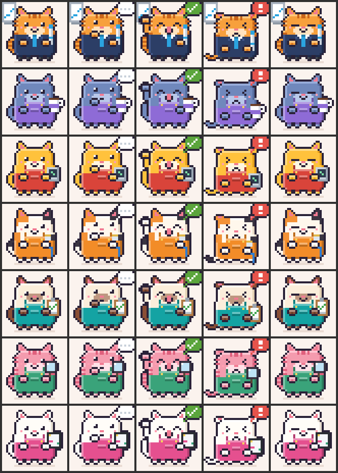

# agent-office-cats: the Cat Office

A fork of [Saharat's agent-stage](https://github.com/Saharatjj/agent-stage) with
chubby office cats, a compact layout and plain, simple words.



A Claude Code mod that shows what Claude and its helpers (subagents) are doing
while they work: a thin row per agent with an animated pixel figure for its
role, and a 0 to 100% progress bar above the prompt. Works in the terminal and
in the desktop app's Code tab.

## What you see

- **A pixel-office header** with "Cat Office" and a summary: `2 working · 1 done`. The terminal shows the same as one line.
- **A thin row per agent.** The lead (Main) first, then up to six helpers, running ones first. Each row shows:
  - the task (for Main, your request)
  - the status: `● Working`, `◐ Thinking`, `✓ Done (34 sec)`, `✗ Error (20 sec)` or `○ Waiting for you`
  - what it is doing right now, in a few words: "Reading progress.ts", "Running npm test"
  - its own little bar: the whole run's progress for Main; for a helper at work a sliding bar, since nobody knows how far along it is; full green when it is done, full red on an error
- **A figure per role**, chosen from the subagent's type and description:

  | Role | Office cats (default) | Space crew | Robots |
  | --- | --- | --- | --- |
  | Team Lead (Main) | orange tabby in a suit, marker, whiteboard | Commander, gold visor | headset, tablet |
  | Planner | blue-grey cat, coffee mug | Navigator, glass bubble helmet | cap, clipboard |
  | Coder | golden cat, laptop | Engineer, scan-slit helmet | beanie, laptop |
  | Tester | calico cat, LAN cable | Test pilot, orange suit | goggles, flask |
  | Reviewer | siamese cat, checklist | Inspector, porthole helmet | monocle, stamp |
  | Researcher | pink tabby, magnifying glass | Astronomer, fur-hooded parka | glasses, magnifying glass |
  | Designer | white cat, iPad | Star artist, paint-splat suit | beret, paintbrush |

  The cats wear overalls in their role's color.

  Figures walk while working, think after a quiet spell, cheer when done and slump on failure.
- **Small in the terminal.** Each row's figure is head and shoulders at half size; a pane too narrow for it shows the text alone, and more rows than fit scroll.
- **A progress bar** above the prompt (on the desktop with the office cats, a little cat walks it toward a fish, and cheers for a moment after an answer): done tasks over all tasks when Claude keeps a plan, else finished subagents over all, else an estimate from tool calls. It only moves forward during a turn and holds at 95% until the turn is done.

## Install

In a terminal Claude Code session:

```
/plugin install agent-office-cats --marketplace Fernsri/agent-office-cats
```

Answer `y` to add the marketplace, then choose the user scope. Installed at the
user scope, it also loads in the desktop app's Code tab. Open the pane any time
with `/office`. It is named apart from agent-stage, so both can be installed;
enable one at a time, or you get two progress bars.

## Settings

Set them with `/plugin configure agent-office-cats@jitapa-mods` in a terminal session.

| Setting | Values | Default |
| --- | --- | --- |
| `skin` | `office-cats`, `space-crew`, `robots` | `office-cats` |
| `backdrop` | `skin` (the figures' own), `terminal` (your terminal's background) | `skin` |
| `theme` | `matcha` (soft greens), `neon`, `ocean`, `sunset`, `mono` (header and bar colors) | `matcha` |
| `fps` | 4 to 30, how often the terminal repaints | `12` |
| `autoOpenPane` | open the pane when a session starts | `true` |

## Update

```
claude plugin update agent-office-cats@jitapa-mods
```

then `/reload-plugins` in any open session.

What changed in each version: [CHANGELOG.md](CHANGELOG.md).

## Develop

The hooks live in `hooks/`: `register.tsx` wires the events and draws the
pane and band; `cards.ts`, `run.ts`, `activity.ts` and `progress.ts` hold the
logic; `cats.ts`, `robots.ts` and `astronauts.ts` draw the figures, and
`stage.ts` holds the table of skins, so a new skin is one more entry there.

```
claude plugin validate .
claude plugin test .
```
